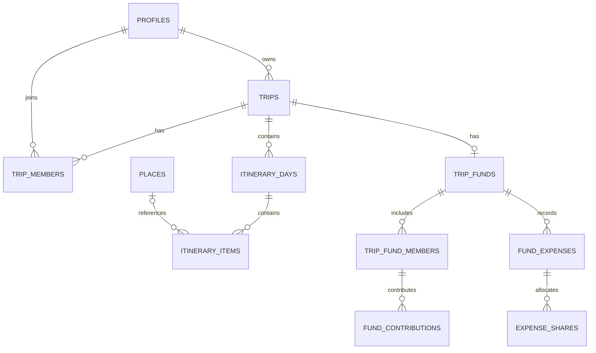

# Data Requirements & Conceptual ERD

> Mô hình khái niệm; chưa phải SQL migration đã chạy. Database Designer/Tech Lead cần review.

| Entity | Mục đích | Trường gợi ý |
|---|---|---|
| profiles | Hồ sơ | id, display_name, avatar_url |
| trips | Chuyến đi | id, owner_id, title, destination_text, start_date, end_date, budget_amount, currency, status |
| trip_members | Thành viên | id, trip_id, user_id, role, joined_at, status |
| itinerary_days | Ngày lịch | id, trip_id, date, day_order |
| places | Địa điểm tham chiếu | id, provider, provider_place_id, name, address, lat, lng, source_updated_at |
| itinerary_items | Hoạt động | id, itinerary_day_id, place_id nullable, title, start_time, end_time, note, sort_order |
| trip_funds | Quỹ | id, trip_id, manager_id, target_per_member, currency, due_at, status |
| trip_fund_members | Nghĩa vụ góp | id, fund_id, user_id, required_amount, status |
| fund_contributions | Lịch sử góp | id, fund_member_id, amount, method, status, recorded_by, reference, created_at |
| fund_expenses | Khoản chi | id, fund_id, title, amount, category, spent_at, recorded_by, status |
| expense_shares | Phân bổ | id, expense_id, user_id, share_amount |
| payment_transactions | Giao dịch online | id, contribution_id, provider, provider_reference, amount, status |
| fund_audit_logs | Audit log | id, fund_id, actor_id, action, before_json, after_json, created_at |

## Quan hệ
- profiles 1—N trips (owner).
- trips 1—N trip_members.
- trips 1—N itinerary_days; mỗi ngày có nhiều itinerary_items.
- places 1—N itinerary_items (place có thể null).
- trips 1—0..1 quỹ active.
- trip_funds 1—N trip_fund_members; mỗi thành viên có nhiều contributions.
- trip_funds 1—N fund_expenses; mỗi khoản có nhiều expense_shares.
- contributions 1—N payment_transactions.
- trip_funds 1—N audit logs.

## ERD Mermaid

## Data decisions
- UUID hay ID khác; VND hay đa tiền tệ; timezone.
- Unique (trip_id,user_id) cho trip_members.
- Unique (fund_id,user_id) cho fund members.
- Quy tắc hoàn/hủy và phân bổ làm tròn.
- RLS cho bảng dữ liệu riêng tư/tài chính.
- Không đưa service-role key xuống Flutter.
