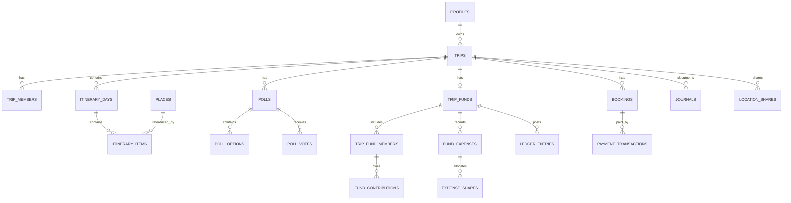

# Data Requirements & Conceptual ERD

> Conceptual model only; not a production schema/migration. Tech Lead must review normalization, RLS, indexes, retention and provider contracts.

## Core entities
| Entity | Key fields / purpose |
|---|---|
| profiles | id, display_name, avatar_url, preferences |
| trips | id, owner_id, title, destination, start_date, end_date, budget_amount, currency, status |
| trip_members | id, trip_id, user_id, role, status, joined_at |
| itinerary_days | id, trip_id, date, day_order |
| places | id, provider, provider_place_id, category, name, address, lat, lng, source_url, fetched_at |
| place_media | id, place_id, media_url, attribution, license/source |
| favorites | id, user_id, place_id |
| itinerary_items | id, itinerary_day_id, place_id nullable, title, start/end, note, sort_order |
| polls | id, trip_id, created_by, title, selection_mode, closes_at, status |
| poll_options | id, poll_id, option_ref, label |
| poll_votes | id, poll_id, option_id, user_id, created_at |
| trip_funds | id, trip_id, manager_id, target_per_member, currency, due_at, status |
| trip_fund_members | id, fund_id, user_id, required_amount, status |
| fund_contributions | id, fund_member_id, amount, method, status, reference, recorded_by |
| fund_expenses | id, fund_id, title, amount, category, payer_id, status, spent_at |
| expense_shares | id, expense_id, user_id, share_amount |
| ledger_entries | id, fund_id, entry_type, amount, source_type, source_id, status, created_by |
| payment_transactions | id, contribution_id nullable, booking_id nullable, provider, provider_reference, idempotency_key, amount, currency, status |
| refunds | id, payment_transaction_id, amount, provider_reference, status |
| accommodation_offers | id, provider, provider_offer_id, property_id, price, currency, terms_snapshot, fetched_at, expires_at |
| bookings | id, trip_id, provider, provider_booking_ref, offer_id, status, guest_summary, total_amount, currency |
| provider_events | id, provider, event_id, event_type, payload_hash, processed_at, status |
| notifications | id, user_id, type, payload, read_at, created_at |
| offline_sync_state | id, user_id, trip_id, last_synced_at, cursor |
| journals | id, trip_id, author_id, itinerary_day_id, body, visibility |
| journal_media | id, journal_id, storage_key, attribution |
| location_shares | id, trip_id, user_id, audience, started_at, expires_at, stopped_at |
| location_points | id, share_id, lat, lng, recorded_at, expires_at |
| image_search_jobs | id, user_id, storage_key, status, result_metadata |
| ai_sessions | id, user_id, trip_id nullable, input_json, output_json, provider, status, created_at |
| admin_roles | id, name, permissions |
| admin_audit_logs | id, admin_id, action, target_type, target_id, before_json, after_json, created_at |
| provider_configs | id, provider, capability, enabled, secret_reference, config_json |

## Relationship overview
- profiles 1:N trips (owner); trips 1:N members/days/polls/journals.
- itinerary_days 1:N itinerary_items; places 1:N itinerary_items/favorites.
- polls 1:N options/votes; unique vote constraints follow poll selection policy.
- trips 1:0..1 active fund; fund 1:N obligations/contributions/expenses/ledger entries.
- expenses 1:N expense_shares; payment_transactions may link contribution or booking.
- accommodation_offers 1:N bookings; bookings 1:N payment/refund records where provider model supports.
- trips 1:N location_shares; shares 1:N expiring location_points.
- user/admin actions produce notification/audit records.

## ERD – Mermaid (simplified)

## Data/security rules
- Use UUID/primary keys; unique provider+provider object IDs; unique provider event ID for idempotency.
- Store money as integer minor units or fixed decimal with currency; never float.
- Store timestamps UTC; render in trip/user timezone.
- RLS by trip membership and role; admin access separate and audited.
- Secrets live server-side/secret manager; never in Flutter.
- Location points and uploaded images require retention/deletion policy.
- Do not store raw card data. Provider payloads minimize PII and redact secrets.
- Booking/payment/ledger records require immutable history and reconciliation.
- Provider terms/license govern media and cached content.
- Confirm data retention, privacy, child data and cross-border processing with PO/legal.