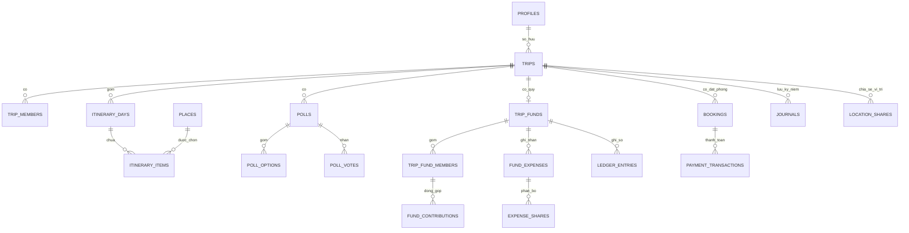

# BỘ TÀI LIỆU PHÂN TÍCH NGHIỆP VỤ TRAVELGO
Phiên bản tiếng Việt – Bản nền đề xuất để PO, BA, UX/UI, Developers và QA cùng rà soát.

> **Trạng thái:** Định hướng tính năng dưới đây đã được người dùng lựa chọn. Các nội dung phụ thuộc nhà cung cấp, hợp đồng, pháp lý, ngân sách, dữ liệu thực tế hoặc chưa được PO quyết định đều được đánh dấu **CẦN XÁC NHẬN**. Đây chưa phải cam kết phát hành hay thiết kế kỹ thuật cuối cùng.

## 1. Tổng quan sản phẩm

TravelGo là ứng dụng hỗ trợ người dùng khám phá điểm đến, quán ăn, nhà hàng, quán cà phê, khu vui chơi; lập lịch trình; phối hợp nhóm; quản lý ngân sách/quỹ; tìm và đặt nơi lưu trú; thanh toán theo khả năng đối tác; đồng thời cung cấp công cụ quản trị qua Admin Web.

**Tầm nhìn đề xuất:** Giúp nhóm bạn và gia đình tổ chức chuyến đi phù hợp sở thích và ngân sách trong một nền tảng thống nhất.

**Vấn đề giả định:** Người tổ chức phải tổng hợp thông tin từ nhiều nguồn, xin ý kiến thành viên và theo dõi chi phí thủ công. Giả định này cần được kiểm chứng bằng phỏng vấn người dùng thật; không trình bày như kết quả nghiên cứu sơ cấp.

## 2. Phạm vi theo giai đoạn

### MVP – sản phẩm khả dụng tối thiểu
- Đăng ký, đăng nhập, hồ sơ người dùng.
- Tạo chuyến, mời thành viên và phân quyền cơ bản.
- Tìm địa điểm du lịch, nhà hàng, quán ăn, cà phê, vui chơi; xem chi tiết và nguồn dữ liệu.
- Lập lịch trình theo ngày, thêm địa điểm/hoạt động, bản đồ cơ bản.
- Bình chọn địa điểm/lịch trình.
- Ngân sách dự kiến, quỹ nhóm, ghi nhận góp/chi thủ công.
- Chia hóa đơn cơ bản, tính số dư/công nợ.
- Thông báo trong ứng dụng.
- AI tạo lịch trình nháp; người dùng phải xem và xác nhận trước khi lưu.

### Giai đoạn 2
- Tìm và so sánh khách sạn/homestay/resort.
- Chuyển sang nhà cung cấp ngoài để đặt phòng.
- Đặt phòng ngay trong TravelGo nếu đối tác cấp API/hợp đồng và hỗ trợ quy trình cần thiết.
- QR góp quỹ và đối soát khi ngân hàng/nhà cung cấp hỗ trợ.
- Admin Web đầy đủ: người dùng, nội dung, danh mục, nhà cung cấp, đặt phòng, thanh toán, báo cáo, nhật ký.
- Xem chuyến ngoại tuyến, nhật ký du lịch, chia sẻ vị trí tự nguyện có thời hạn, tìm địa điểm bằng ảnh.
- Thông báo đẩy/email nếu có sự đồng ý và tích hợp phù hợp.

### Giai đoạn 3
- Cổng thanh toán trực tuyến nhiều nhà cung cấp, hoàn tiền và đối soát tự động.
- Trợ lý AI hội thoại toàn diện, tối ưu tuyến đường/ngân sách, gợi ý phương án thay thế.
- Tích hợp tìm/đặt vé xe, tàu, máy bay.
- Đánh giá/cộng đồng có kiểm duyệt, phân tích dữ liệu và cá nhân hóa nâng cao.

**Lưu ý:** Phân chia trên là đề xuất. PO phải chốt MVP theo năng lực và thời gian của nhóm. Không được hiểu rằng TravelGo đã có quyền sử dụng API Booking/Agoda, API ngân hàng hay cổng thanh toán.

## 3. Vai trò người dùng và phân quyền

| Vai trò | Quyền đề xuất |
|---|---|
| Organizer (Người tổ chức) | Tạo chuyến, mời thành viên, quản lý lịch trình, quản lý quỹ và quyết toán |
| Editor (Người chỉnh sửa) | Chỉnh lịch trình và nội dung chuyến theo quyền được cấp |
| Member (Thành viên) | Xem chuyến, bình chọn, xem nghĩa vụ góp và thông tin được chia sẻ |
| Viewer (Người xem) | Chỉ xem nội dung được cấp quyền |
| Admin | Quản trị nền tảng theo vai trò quản trị riêng |

**Cần PO xác nhận:** Member có được thêm/sửa hoạt động không; Editor có được mời người khác không; ai được xem toàn bộ thông tin quỹ; Admin hỗ trợ tài chính đến mức nào. Kiểm tra quyền phải thực hiện ở máy chủ, không chỉ ẩn nút trên giao diện.

## 4. Yêu cầu chức năng (Functional Requirements)

| Mã | Yêu cầu | Giai đoạn | Ưu tiên đề xuất |
|---|---|---|---|
| FR-01 | Đăng ký, đăng nhập, đăng xuất, quản lý hồ sơ | MVP | Bắt buộc |
| FR-02 | Tạo, xem, sửa, lưu trữ chuyến đi | MVP | Bắt buộc |
| FR-03 | Mời thành viên, chấp nhận lời mời, phân quyền | MVP | Bắt buộc |
| FR-04 | Tạo lịch trình theo ngày; thêm/sửa/xóa/sắp xếp hoạt động | MVP | Bắt buộc |
| FR-05 | Tìm địa điểm, nhà hàng, quán ăn, cà phê, vui chơi | MVP | Bắt buộc |
| FR-06 | Lọc theo khu vực, danh mục, giá, đánh giá, khoảng cách nếu nguồn hỗ trợ | MVP | Nên có |
| FR-07 | Xem chi tiết, ảnh, địa chỉ, bản đồ, nguồn và thời điểm cập nhật | MVP | Bắt buộc |
| FR-08 | Lưu yêu thích và thêm địa điểm vào lịch trình | MVP | Nên có |
| FR-09 | Hiển thị địa điểm/lịch trình trên bản đồ | MVP | Nên có |
| FR-10 | Tạo bình chọn địa điểm/lịch trình, đóng bình chọn, xem kết quả | MVP | Nên có |
| FR-11 | Đặt ngân sách theo chuyến/danh mục và theo dõi thực chi | MVP | Bắt buộc |
| FR-12 | Organizer tạo quỹ, mức góp, hạn góp và danh sách thành viên | MVP | Nên có |
| FR-13 | Ghi nhận khoản góp/chi thủ công, lưu lịch sử | MVP | Nên có |
| FR-14 | Chia đều hoặc chia theo người tham gia, tính công nợ | MVP | Nên có |
| FR-15 | AI tạo lịch trình nháp từ điểm đến, ngày, ngân sách, sở thích | MVP | Nên có |
| FR-16 | Người dùng xem, sửa, xác nhận bản nháp AI trước khi lưu | MVP | Bắt buộc nếu bật AI |
| FR-17 | Thông báo trong ứng dụng về lời mời, bình chọn, lịch, quỹ | MVP | Nên có |
| FR-18 | Tìm nơi lưu trú theo ngày, số khách, giá, tiện nghi | Giai đoạn 2 | Nên có |
| FR-19 | Hiển thị lựa chọn phòng, giá, điều kiện, nguồn, thời điểm cập nhật | Giai đoạn 2 | Bắt buộc |
| FR-20 | Chuyển sang nhà cung cấp ngoài qua liên kết đối tác | Giai đoạn 2 | Nên có |
| FR-21 | Đặt phòng trong TravelGo qua API đối tác khi được hỗ trợ | Giai đoạn 2 | Nên có |
| FR-22 | Tạo QR/hướng dẫn chuyển khoản và đối soát | Giai đoạn 2 | Nên có |
| FR-23 | Tích hợp cổng thanh toán, webhook, hoàn tiền tự động | Giai đoạn 3 | Có thể có |
| FR-24 | Admin quản lý người dùng, vai trò, nội dung, danh mục, báo cáo | Giai đoạn 2 | Bắt buộc |
| FR-25 | Admin quản lý nhà cung cấp, tác vụ đồng bộ, đặt phòng/thanh toán, nhật ký | Giai đoạn 2 | Bắt buộc |
| FR-26 | Lưu chuyến để xem ngoại tuyến | Giai đoạn 2 | Nên có |
| FR-27 | Nhật ký chuyến đi, ảnh và ghi chú theo ngày | Giai đoạn 2 | Có thể có |
| FR-28 | Chia sẻ vị trí tự nguyện, giới hạn người nhận và thời gian | Giai đoạn 2 | Nên có |
| FR-29 | Tìm địa điểm bằng hình ảnh | Giai đoạn 2 | Có thể có |
| FR-30 | Trợ lý AI hội thoại, tối ưu tuyến đường/ngân sách | Giai đoạn 3 | Có thể có |
| FR-31 | Tìm/đặt phương tiện và đánh giá/cộng đồng có kiểm duyệt | Giai đoạn 3 | Có thể có |

## 5. Ca sử dụng (Use Cases)

### UC-01 – Tạo chuyến
Người dùng đăng nhập, nhập tên chuyến, điểm đến, ngày đi/về, tiền tệ và ngân sách tùy chọn. Hệ thống kiểm tra dữ liệu, tạo chuyến và gán người tạo làm Organizer.

### UC-02 – Lập lịch trình
Organizer/Editor chọn ngày, tìm địa điểm hoặc thêm hoạt động thủ công, nhập giờ/ghi chú, lưu và sắp xếp. Hệ thống kiểm tra ngày thuộc chuyến và quyền chỉnh sửa.

### UC-03 – Khám phá địa điểm
Người dùng tìm theo từ khóa/danh mục/khu vực, lọc kết quả, xem chi tiết và nguồn dữ liệu, lưu yêu thích hoặc thêm vào lịch trình.

### UC-04 – Mời thành viên
Organizer tạo lời mời. Người nhận xác thực và chấp nhận. Hệ thống kích hoạt thành viên theo vai trò; lời mời bị thu hồi/hết hạn không còn hiệu lực.

### UC-05 – Bình chọn
Organizer/Editor tạo bình chọn, thêm lựa chọn và thời điểm đóng. Thành viên đủ điều kiện bỏ phiếu. Kết quả hiển thị; Organizer xác nhận phương án cuối.

### UC-06 – Tạo và quản lý quỹ
Organizer tạo quỹ, đặt mức góp/hạn góp và danh sách thành viên. Thành viên xem nghĩa vụ. Organizer ghi nhận khoản góp; khoản chưa xác minh không được tính là tiền đã nhận.

### UC-07 – Ghi khoản chi và chia tiền
Organizer nhập khoản chi, người trả, ngày, danh mục, người tham gia và phương pháp chia. Hệ thống tính phần mỗi người và kiểm tra tổng phân bổ bằng tổng chi.

### UC-08 – Quyết toán quỹ
Organizer xem tổng góp, tổng chi, số dư quỹ và số dư ròng từng thành viên. Hệ thống tạo báo cáo. Việc hoàn tiền dư/thu thêm khi thiếu chỉ thực hiện theo chính sách PO đã duyệt.

### UC-09 – Tạo lịch trình bằng AI
Người dùng nhập điểm đến, ngày, ngân sách, sở thích và ràng buộc. AI trả bản nháp có cảnh báo/nguồn. Người dùng sửa và xác nhận trước khi lưu.

### UC-10 – Tìm và đặt phòng ngoài ứng dụng
Người dùng tìm nơi lưu trú, xem lựa chọn/giá/điều kiện và chuyển sang website/ứng dụng đối tác. TravelGo chỉ ghi nhận lượt chuyển nếu điều khoản cho phép; không tự nhận đặt phòng đã thành công.

### UC-11 – Đặt phòng trong ứng dụng
Người dùng chọn lựa chọn được đối tác hỗ trợ, nhập thông tin khách, xem tổng tiền/chính sách hủy và xác nhận. Máy chủ gửi yêu cầu có khóa chống trùng, lưu mã đối tác và đối soát trạng thái. Chỉ báo thành công khi đối tác xác nhận.

### UC-12 – Góp quỹ qua QR/thanh toán
Organizer tạo yêu cầu góp. Hệ thống hiển thị QR/hướng dẫn theo chuẩn đối tác. Giao dịch chỉ được xác nhận sau xác minh/đối soát; webhook trùng không cộng tiền lần hai.

### UC-13 – Xem chuyến ngoại tuyến
Người dùng tải dữ liệu chuyến; khi mất mạng có thể xem lịch trình, địa điểm đã lưu và mã đặt chỗ. Hiển thị thời điểm đồng bộ gần nhất. Thao tác tài chính/đặt phòng không thực hiện ngoại tuyến.

### UC-14 – Nhật ký, vị trí và tìm bằng ảnh
Thành viên tạo ghi chú/ảnh theo ngày; chủ động chia sẻ vị trí có thời hạn; hoặc tải ảnh để nhận gợi ý địa điểm. Các chức năng này phải kiểm soát quyền, đồng ý và thời hạn lưu dữ liệu.

### UC-15 – Quản trị hệ thống
Admin đăng nhập theo vai trò, xem bảng điều khiển, quản lý tài khoản/nội dung/danh mục/nhà cung cấp, tra cứu giao dịch và báo cáo. Thao tác nhạy cảm phải có quyền và nhật ký.

## 6. Quy tắc nghiệp vụ (Business Rules)

### Chuyến đi và cộng tác
- BR-01: Ngày kết thúc phải bằng hoặc sau ngày bắt đầu.
- BR-02: Mỗi chuyến có một Organizer tại một thời điểm.
- BR-03: Chuyến riêng tư chỉ người được cấp quyền mới được xem.
- BR-04: Máy chủ phải kiểm tra quyền trên mọi thao tác dữ liệu.
- BR-05: Mã mời phải khó đoán, có hạn và thu hồi được.
- BR-06: Chỉ thành viên đang hoạt động được bình chọn.
- BR-07: Kết quả bình chọn là tham khảo; Organizer chốt phương án.

### Địa điểm và nội dung
- BR-08: Dữ liệu từ đối tác phải lưu mã nguồn, mã địa điểm và thời điểm lấy dữ liệu.
- BR-09: Không tự tạo giá, đánh giá, giờ mở cửa, phòng trống hoặc độ phổ biến.
- BR-10: “Địa điểm đang hot” phải có tiêu chí xếp hạng rõ ràng.
- BR-11: Nội dung người dùng gửi phải tuân theo chính sách kiểm duyệt.
- BR-12: Kết quả nhận diện địa điểm bằng ảnh chỉ là gợi ý, người dùng xác nhận.

### Đặt phòng
- BR-13: Chỉ hiển thị lựa chọn do nhà cung cấp trả về.
- BR-14: Giá/tồn phòng có thể thay đổi tới khi đối tác xác nhận.
- BR-15: Đặt trong ứng dụng cần API/hợp đồng và quy trình hủy/hoàn phù hợp.
- BR-16: Liên kết ngoài không đồng nghĩa đặt phòng thành công.
- BR-17: Khi timeout/trạng thái chưa rõ, phải đối soát trước khi thử lại.

### Quỹ và chia chi phí
- BR-18: Mỗi chuyến tối đa một quỹ đang hoạt động, trừ khi PO cho phép nhiều quỹ.
- BR-19: Chỉ Organizer quản lý quỹ theo định hướng hiện tại.
- BR-20: Mức góp bằng nhau là mặc định; danh sách người phải góp cần xác định.
- BR-21: Organizer có phải góp như thành viên hay không **cần PO xác nhận**.
- BR-22: Chỉ khoản góp đã xác nhận mới làm tăng số dư quỹ.
- BR-23: Chi phí chung chỉ chia cho những người được chọn tham gia.
- BR-24: Tổng phần chia phải bằng chính xác tổng khoản chi sau xử lý làm tròn.
- BR-25: Chi phí cá nhân không tự động đưa vào quỹ chung.
- BR-26: Giao dịch đã xác nhận không xóa trực tiếp; điều chỉnh bằng bút toán đảo có nhật ký.
- BR-27: Cách xử lý tiền dư/thiếu cuối chuyến **cần PO xác nhận**.

### Thanh toán và bảo mật
- BR-28: Ứng dụng phía người dùng không được tự đánh dấu thanh toán thành công.
- BR-29: Máy chủ xác minh callback/chữ ký và trạng thái từ nhà cung cấp.
- BR-30: Webhook phải chống xử lý trùng.
- BR-31: Giao dịch chờ/thất bại/đã hủy không làm tăng số dư đã xác nhận.
- BR-32: Hoàn tiền liên kết giao dịch gốc và có trạng thái riêng.
- BR-33: Không lưu dữ liệu thẻ thô hoặc khóa bí mật ở ứng dụng.
- BR-34: Không mặc định TravelGo được giữ tiền/vận hành ví; phải rà soát pháp lý/đối tác.

### Admin, AI và quyền riêng tư
- BR-35: Admin được cấp ít quyền nhất; thao tác nhạy cảm phải ghi nhật ký.
- BR-36: Chia sẻ vị trí tự nguyện, giới hạn người nhận, có thời hạn và có thể dừng.
- BR-37: Dữ liệu ngoại tuyến phải ghi thời điểm đồng bộ; máy chủ là nguồn dữ liệu chuẩn.
- BR-38: AI chỉ tư vấn; người dùng xem và xác nhận trước khi lưu/thực hiện.
- BR-39: AI không tự đặt phòng, thanh toán, chia sẻ vị trí hoặc tiết lộ dữ liệu người khác.
- BR-40: Không theo dõi vị trí nền liên tục theo mặc định.

## 7. Tiêu chí chấp nhận (Acceptance Criteria)

- **Chuyến đi:** Khi người dùng đăng nhập và nhập ngày hợp lệ, chuyến được tạo và gắn với Organizer. Ngày kết thúc trước ngày bắt đầu phải bị từ chối.
- **Phân quyền:** Người không có quyền sửa không thể thay đổi dữ liệu kể cả khi gọi API trực tiếp.
- **Khám phá:** Tìm kiếm có trạng thái đang tải/thành công/không có kết quả/lỗi. Thiếu giá, đánh giá hoặc giờ mở cửa thì không tự tạo dữ liệu.
- **Bình chọn:** Thành viên đủ điều kiện bỏ phiếu đúng quy tắc; bình chọn đã đóng không nhận phiếu mới; Organizer xác nhận kết quả cuối.
- **Quỹ:** Khoản góp chờ xác minh không tính vào số dư. Tổng phần chia bằng tổng khoản chi. Chỉnh sửa giao dịch đã xác nhận phải tạo bút toán điều chỉnh và nhật ký.
- **Đặt phòng ngoài:** Liên kết đối tác được ghi rõ là đặt bên ngoài; không hiển thị đã xác nhận khi chưa có phản hồi đối tác.
- **Đặt trong ứng dụng:** Chỉ bật khi đối tác hỗ trợ; phải lưu mã/trạng thái xác nhận từ máy chủ; timeout phải đối soát trước khi thử lại.
- **Thanh toán:** Giao dịch chờ/thất bại/đã hủy không cộng vào quỹ. Webhook trùng không tạo giao dịch trùng. Hoàn tiền phải liên kết giao dịch gốc.
- **Admin:** Người không phải Admin bị từ chối ở máy chủ; thao tác nhạy cảm ghi người làm, đối tượng, thời gian, lý do và kết quả.
- **Ngoại tuyến:** Có thể xem dữ liệu đã tải kèm thời điểm đồng bộ; thao tác tài chính/đặt phòng bị chặn khi không có mạng.
- **Vị trí:** Không chia sẻ trước khi người dùng đồng ý; dừng/hết hạn thì không gửi vị trí mới.
- **Ảnh:** Kiểm tra loại/kích thước/quyền tải; kết quả là gợi ý, có thể từ chối.
- **AI:** Bản nháp sửa/từ chối được; không phát sinh đặt phòng/thanh toán nếu chưa xác nhận; lỗi AI không tạo bản ghi trùng.

## 8. Yêu cầu phi chức năng

| Nhóm | Yêu cầu |
|---|---|
| Bảo mật | RLS/phân quyền ở máy chủ; không đưa bí mật vào mã nguồn |
| Quyền riêng tư | Thu thập tối thiểu; quy định thời hạn lưu ảnh/vị trí |
| Hiệu năng | Nhóm xác định ngưỡng tải trên thiết bị mục tiêu |
| Độ tin cậy | Có trạng thái tải/rỗng/lỗi và khả năng thử lại |
| Khả dụng | Người mới có thể tạo chuyến mà không cần hướng dẫn trực tiếp |
| Tương thích | Kiểm thử trên phiên bản Android/iOS được cam kết |
| Bảo trì | Có quy ước mã, module và tài liệu cài đặt |
| AI | Đầu ra theo cấu trúc, có thể chỉnh sửa và kiểm soát chi phí |
| Tài chính | Giao dịch có đối soát, chống trùng, nhật ký và lịch sử bất biến |

Các ngưỡng định lượng như thời gian phản hồi, tải đồng thời, phiên bản hệ điều hành tối thiểu và ngân sách API **cần nhóm/PO chốt**.

## 9. Mô hình dữ liệu và ERD

### Các bảng/thực thể đề xuất
| Thực thể | Mục đích |
|---|---|
| profiles | Hồ sơ người dùng |
| trips | Chuyến đi, chủ sở hữu, điểm đến, ngày, ngân sách |
| trip_members | Thành viên và vai trò trong chuyến |
| itinerary_days | Các ngày của lịch trình |
| itinerary_items | Hoạt động trong từng ngày |
| places | Địa điểm và mã nguồn dữ liệu |
| place_media | Hình ảnh, nguồn và giấy phép |
| favorites | Địa điểm yêu thích |
| polls, poll_options, poll_votes | Bình chọn và phiếu |
| trip_funds | Quỹ chuyến đi |
| trip_fund_members | Nghĩa vụ góp của thành viên |
| fund_contributions | Các khoản góp |
| fund_expenses | Các khoản chi |
| expense_shares | Phần chi của từng thành viên |
| ledger_entries | Sổ bút toán quỹ |
| payment_transactions | Giao dịch thanh toán |
| refunds | Giao dịch hoàn tiền |
| accommodation_offers | Lựa chọn phòng/giá từ nhà cung cấp |
| bookings | Đặt phòng và mã đối tác |
| provider_events | Sự kiện callback/webhook từ đối tác |
| notifications | Thông báo |
| offline_sync_state | Trạng thái đồng bộ ngoại tuyến |
| journals, journal_media | Nhật ký và ảnh |
| location_shares, location_points | Phiên chia sẻ và điểm vị trí có thời hạn |
| image_search_jobs | Tác vụ tìm kiếm địa điểm bằng ảnh |
| ai_sessions | Phiên yêu cầu AI |
| admin_roles, admin_audit_logs | Vai trò và nhật ký quản trị |
| provider_configs | Cấu hình tích hợp nhà cung cấp |

### Quan hệ chính
- Một hồ sơ có thể sở hữu nhiều chuyến; một chuyến có nhiều thành viên và ngày lịch trình.
- Một ngày có nhiều hoạt động; một địa điểm có thể được dùng trong nhiều hoạt động.
- Một chuyến có nhiều bình chọn; mỗi bình chọn có nhiều lựa chọn và phiếu.
- Một chuyến có tối đa một quỹ đang hoạt động; quỹ có nhiều nghĩa vụ góp, khoản góp, khoản chi và bút toán.
- Một khoản chi có nhiều phần phân bổ.
- Một chuyến có thể có nhiều lựa chọn lưu trú/đặt phòng.
- Giao dịch thanh toán có thể liên kết khoản góp hoặc đặt phòng.
- Một chuyến có thể có nhiều nhật ký và phiên chia sẻ vị trí.

### ERD rút gọn (Mermaid)

**Lưu ý kỹ thuật:** tiền lưu bằng số nguyên theo đơn vị nhỏ nhất hoặc kiểu thập phân cố định kèm tiền tệ; không dùng float. Thời gian lưu UTC và hiển thị theo múi giờ phù hợp. RLS dựa trên thành viên/vai trò. Bí mật chỉ ở máy chủ. Ảnh/vị trí phải có chính sách lưu/xóa.

## 10. API và tích hợp

Các tuyến dưới đây là hình dạng minh họa, chưa phải thiết kế API cuối cùng:
- `POST /trips`, `GET /trips`, `GET /trips/{tripId}`
- `POST /trips/{tripId}/members/invitations`
- `GET /places?query=&category=&lat=&lng=&radius=`
- `POST /trips/{tripId}/itinerary/items`
- `POST /trips/{tripId}/polls`, `POST /polls/{pollId}/votes`
- `POST /trips/{tripId}/funds`, `POST /funds/{fundId}/contributions`
- `POST /funds/{fundId}/expenses`, `POST /expenses/{expenseId}/shares`
- `POST /ai/itinerary-drafts`
- `GET /accommodations/offers?destination=&checkIn=&checkOut=&guests=`
- `POST /bookings`, `GET /bookings/{bookingId}`, `POST /bookings/{bookingId}/cancel`
- `POST /payments/instructions`, `GET /payments/{transactionId}`
- `POST /webhooks/{provider}` (chỉ nhận sự kiện máy chủ đối tác)
- `GET /admin/dashboard`, các tuyến quản trị người dùng/địa điểm/nhà cung cấp
- `POST /trips/{tripId}/offline-package`, `POST /sync`
- `POST /location-shares`, `POST /location-shares/{id}/stop`
- `POST /image-search-jobs`

### Nhóm tích hợp cần lựa chọn
- Bản đồ/địa điểm: giấy phép, hạn mức, chi phí, độ mới dữ liệu.
- OTA/lưu trú: hợp đồng, tồn phòng, hủy, callback và liên kết đối tác.
- Ngân hàng/cổng thanh toán: mở tài khoản đơn vị chấp nhận thanh toán, chữ ký, đối soát và pháp lý.
- AI: quyền riêng tư, chi phí, độ trễ, an toàn và cấu trúc đầu ra.
- Push/email: sự đồng ý, khả năng gửi và hạn mức.
- Lưu trữ ảnh: quyền truy cập, thời hạn lưu và chi phí.

## 11. Product Backlog – User Story đề xuất

### MVP
- US-01: Là người dùng, tôi muốn đăng nhập để quản lý chuyến.
- US-02: Là Organizer, tôi muốn tạo và sửa chuyến.
- US-03: Là Organizer, tôi muốn mời thành viên và gán vai trò.
- US-04: Là thành viên, tôi muốn xem chuyến được chia sẻ đúng quyền.
- US-05: Là người dùng, tôi muốn tìm địa điểm, quán ăn và khu vui chơi.
- US-06: Là người dùng, tôi muốn xem nguồn dữ liệu và lưu địa điểm yêu thích.
- US-07: Là Organizer, tôi muốn lập lịch trình theo ngày.
- US-08: Là thành viên, tôi muốn bình chọn địa điểm/kế hoạch.
- US-09: Là Organizer, tôi muốn đặt ngân sách và mức góp quỹ.
- US-10: Là Organizer, tôi muốn ghi nhận khoản góp và khoản chi thủ công.
- US-11: Là thành viên, tôi muốn xem trạng thái góp/chi của mình.
- US-12: Là Organizer, tôi muốn chia chi phí chung và xem số dư.
- US-13: Là người dùng, tôi muốn tạo và chỉnh sửa bản nháp lịch trình AI.
- US-14: Là người dùng, tôi muốn nhận thông báo trong ứng dụng.
- US-15: Là người dùng, tôi muốn xem các địa điểm trên bản đồ.

### Giai đoạn 2
- US-21: Tìm và so sánh nơi lưu trú.
- US-22: Chuyển sang đối tác để đặt phòng.
- US-23: Đặt trong ứng dụng khi API/hợp đồng cho phép.
- US-24: Theo dõi trạng thái/hủy đặt phòng.
- US-25: Tạo yêu cầu góp quỹ bằng QR.
- US-26: Đối soát chuyển khoản/thanh toán.
- US-27: Admin Web quản lý người dùng, nội dung, nhà cung cấp và báo cáo.
- US-28: Tải chuyến để xem ngoại tuyến.
- US-29: Tạo nhật ký kèm ảnh.
- US-30: Chia sẻ vị trí tự nguyện có thời hạn.
- US-31: Tìm địa điểm bằng ảnh.
- US-32: Nhận thông báo đẩy/email.

### Giai đoạn 3
- US-41: Tích hợp nhiều cổng thanh toán và tự động hoàn tiền.
- US-42: Trợ lý AI hội thoại nâng cao.
- US-43: Tối ưu tuyến đường và ngân sách.
- US-44: Tích hợp tìm/đặt phương tiện.
- US-45: Đánh giá/cộng đồng có kiểm duyệt.
- US-46: Phân tích dữ liệu và cá nhân hóa nâng cao.

### Mục tiêu Sprint 1 đề xuất
Người dùng đăng nhập có thể tạo chuyến, thêm hoạt động lịch trình và lưu dữ liệu với kiểm soát quyền. Chưa đưa đặt phòng/thanh toán vào Sprint 1 khi luồng chuyến đi và bảo mật cốt lõi chưa ổn định.

### Điều kiện sẵn sàng (DoR)
User Story có người dùng/giá trị, phạm vi, tiêu chí chấp nhận, phụ thuộc, tác động dữ liệu/quyền riêng tư, trạng thái giao diện, trường hợp lỗi và ước lượng.

### Điều kiện hoàn thành (DoD)
Mã được rà soát; kiểm thử đạt; kiểm thử phân quyền/RLS đạt; tài liệu cập nhật; tiêu chí chấp nhận đạt; không còn lỗi bảo mật nghiêm trọng đã biết; có thể trình diễn phần tăng trưởng sản phẩm (Increment).

## 12. Admin Web – phạm vi quản trị đầy đủ

1. Bảng điều khiển: người dùng, chuyến đang hoạt động, lượt tìm kiếm, tình trạng đặt phòng/thanh toán và sự cố.
2. Quản lý tài khoản: tìm kiếm, trạng thái, hỗ trợ, khóa/mở theo quyền và lý do.
3. Quản lý nội dung: địa điểm, danh mục, điểm đến, bộ sưu tập, nội dung bị báo cáo.
4. Quản lý nhà cung cấp: bật/tắt tích hợp, trạng thái đồng bộ, hạn mức và tình trạng hoạt động.
5. Quản lý đặt phòng: tra mã đối tác, trạng thái, đối soát và ghi chú hỗ trợ.
6. Quản lý thanh toán: tra giao dịch, webhook, đối soát và quy trình yêu cầu hoàn tiền.
7. Báo cáo: người dùng, chuyến, mức sử dụng, chuyển đổi, đặt phòng, thanh toán và kiểm duyệt.
8. Phân quyền quản trị: quản trị viên cấp cao, nội dung, hỗ trợ, tài chính/vận hành, phân tích.
9. Nhật ký: ghi người thao tác, đối tượng, hành động, thời gian, lý do và kết quả.

Admin không được tùy tiện sửa/xóa sổ quỹ hoặc giao dịch tài chính đã xác nhận. Vai trò và quyền cụ thể cần PO/Bảo mật duyệt.

## 13. Trợ lý AI TravelGo

- MVP: tạo lịch trình nháp theo điểm đến, ngày, ngân sách, sở thích, số người và ràng buộc.
- Giai đoạn 3: hỏi đáp theo ngữ cảnh chuyến đi, tối ưu tuyến đường/ngân sách, đề xuất địa điểm thay thế, tóm tắt kế hoạch.
- Kết quả AI phải có cấu trúc, ghi rõ là nội dung do AI đề xuất và cho phép chỉnh sửa/từ chối.
- Dẫn nguồn khi có dữ liệu; nội dung không có nguồn phải ghi chưa xác minh.
- Không bịa giá, giờ mở cửa, tồn phòng, điều kiện đường đi hoặc trạng thái đặt chỗ.
- Không tự đặt phòng, thanh toán, chia sẻ vị trí hay tiết lộ dữ liệu thành viên.
- Cần chọn nhà cung cấp AI, ngân sách, ngôn ngữ, thời hạn lưu dữ liệu và cách đánh giá chất lượng.

## 14. Câu hỏi nghiệp vụ cần PO quyết định

### Quỹ
1. Organizer có phải góp như thành viên không?
2. Thành viên mới tham gia quỹ đóng mức nào?
3. Thành viên rời nhóm xử lý nghĩa vụ ra sao?
4. Tiền góp dư được xử lý thế nào?
5. Tiền còn dư cuối chuyến hoàn đều hay theo số tiền đã góp?
6. Nếu quỹ thiếu, có thu thêm không?
7. Có đổi mức góp sau khi đã có giao dịch không?
8. Trẻ em/người không tham gia một số hoạt động có được chia khác không?

### Đặt phòng/thanh toán
1. Chọn đối tác lưu trú nào? Có API đặt trong ứng dụng không?
2. Đối tác hay TravelGo thu tiền?
3. Ai chịu trách nhiệm hủy, hoàn tiền, hóa đơn, hỗ trợ và tranh chấp?
4. Chọn ngân hàng/cổng thanh toán nào? Có webhook/sao kê để đối soát không?
5. TravelGo có mô hình pháp lý phù hợp để nhận/giữ tiền không?

### Admin/AI/riêng tư
1. Vai trò Admin nào được khóa tài khoản hoặc yêu cầu hoàn tiền?
2. Thao tác rủi ro cao có cần hai người duyệt?
3. Vị trí và ảnh được lưu trong bao lâu?
4. AI dùng nhà cung cấp nào, ngân sách và dữ liệu nào?
5. Quyền Editor/Member/Viewer cụ thể ra sao?

## 15. Kế hoạch nghiên cứu người dùng

- Mục tiêu khám phá ban đầu: 6–8 người đã đi du lịch nội địa có lưu trú ít nhất một đêm trong 6 tháng gần nhất; ưu tiên người trực tiếp lập kế hoạch.
- Hỏi về chuyến gần nhất, cách tìm địa điểm/nơi ở, cách lập lịch, thay đổi kế hoạch, theo dõi chi phí, bất đồng nhóm và trải nghiệm đặt dịch vụ.
- Hỏi hành vi đã xảy ra, không hỏi dẫn dắt kiểu “bạn có muốn dùng ứng dụng không”.
- Chỉ ghi âm khi có đồng ý; ẩn danh ghi chú; không đưa dữ liệu cá nhân lên repository công khai.
- Mẫu 6–8 người chỉ là nghiên cứu định tính khám phá, không đại diện thống kê.
- Không tự điền kết quả phỏng vấn khi chưa thực hiện.

## 16. Yêu cầu phi chức năng và bảo mật bổ sung

- Xác thực và phân quyền ở máy chủ; kiểm thử quyền truy cập chéo chuyến.
- Không đưa service-role key, khóa AI, khóa thanh toán vào ứng dụng di động.
- Giao dịch tài chính/đặt phòng có khóa chống trùng, nhật ký và đối soát.
- Thông tin cá nhân chỉ thu thập theo mục đích cần thiết.
- Dữ liệu vị trí/ảnh có sự đồng ý, quyền truy cập và thời hạn lưu/xóa.
- Dữ liệu ngoại tuyến phải có thời điểm đồng bộ và xử lý xung đột.
- Có giám sát lỗi, chi phí API, hạn mức và độ trễ nhà cung cấp.

## 17. Nguyên tắc phân công trong Scrum

- PO quyết định mục tiêu, thứ tự ưu tiên và phạm vi Product Backlog.
- BA phân tích, đặc tả, làm rõ quy tắc và duy trì truy vết.
- UX/UI thiết kế luồng và giao diện.
- Developers quyết định giải pháp kỹ thuật và triển khai.
- QA xây dựng/ thực hiện kiểm thử theo tiêu chí chấp nhận.
- Scrum Master hỗ trợ nhóm vận hành Scrum.

BA không tự quyết định thay PO về ưu tiên sản phẩm, không tự quyết định thay Tech Lead về kiến trúc và không tự nghiệm thu sản phẩm thay PO.
